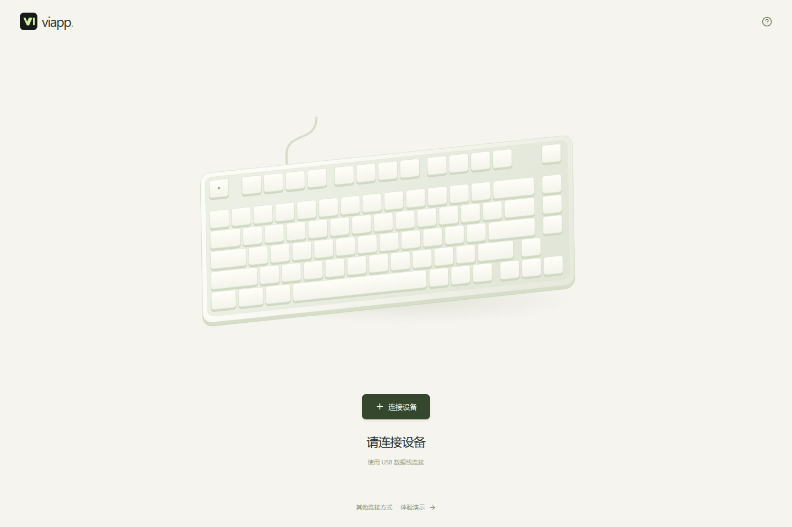
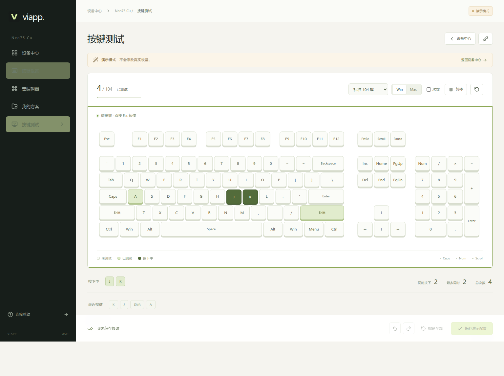

# VIAPP

浏览器中的键盘配置工具，支持改键、宏、方案管理和按键测试。使用 React、TypeScript、Vite，直接连接 USB 设备，无需服务器或账号。当前支持的原装 PCB 见下表。

[打开网页驱动](https://zackleo219.github.io/viapp/) · [下载 Windows 离线版](https://github.com/ZackLeo219/viapp/releases/latest/download/viapp-windows-x64.exe) · [所有下载](https://github.com/ZackLeo219/viapp/releases)



## 支持范围

| 设备                  | 配置接口                     | 能力                                               |
| --------------------- | ---------------------------- | -------------------------------------------------- |
| Neo75 Cu 原装三模 PCB | WebHID / VIA，USB 有线模式   | 读取全部层、改键、原厂自定义键、宏编辑、备份与恢复 |
| TOFU PAD 原装双模 PCB | Web Serial / ZMK Studio，USB | 从设备读取配列和行为、改键、分层、保存与备份       |

使用电脑上的 **Chrome / Edge**。蓝牙仅用于日常输入，不提供蓝牙配置。2.4G 配置尚未验证，不作为受支持功能宣传。Neo 的有线专用 PCB、第三方 PCB、其他型号不在本版本支持范围内。

Neo 支持 VIA 协议 9–12，先协商协议版本再启用写入；未知版本明确拒绝写入。Neo 原厂固件对 ANY、高级组合键及无线模式下的修饰键组合存在限制，因此本项目不提供任意高级键码编辑。TOFU PAD 的行为 ID 和物理布局从设备读取，不把 ZMK 行为误当成 VIA 键码；ZMK Studio 暂不支持在线新建复杂宏。

## 本地开发

欢迎通过 Issue 和 PR 添加原装 PCB 支持，步骤见 [贡献指南](CONTRIBUTING.md)。**Neo65 Cu、Neo80 Cu** 列为待适配型号，目前尚未验证，暂不在驱动中开放。

需要 Node.js 22.12+（推荐 24 LTS）和 pnpm 10.33.0。

```sh
pnpm install --frozen-lockfile
pnpm dev
```

打开 `http://localhost:5173/`。WSL 下在 **Windows 的 Chrome / Edge** 打开这个地址，设备连接在 Windows 主机上；不需要把 USB 转交给 WSL。

```sh
pnpm check       # 类型检查、协议与数据完整性测试、生产构建
pnpm exec playwright install chromium
pnpm test:e2e    # 实际浏览器流程、移动布局和离线缓存测试
```

## 使用

1. 首页是设备中心，未连接时只显示连接引导。插入能传输数据的 USB 线；Neo75 Cu 需切换到有线模式。
2. 已授权设备会自动识别，插入 USB 后显示设备卡片。首次使用点击「连接设备」，在浏览器弹窗中授权；列表中没有设备时，点击「其他连接方式」使用串口授权。无需在网页选择型号。请关闭 VIA / ZMK Studio 等同时占用设备的应用。
3. 点击设备卡片进入工作台。选中键位后，可点击「录入按键」并按下目标键，也可搜索或按分类选择功能，顶部切换层。两台键盘可同时连接，各自保留草稿和撤销记录；自动发现另一台设备不会打断当前编辑。
4. 点击「保存到键盘」，检查差异。应用会重新读取设备以检测外部修改，保存本地备份，执行写入，最后读回核对。
5. 进入具体设备后，在「我的方案」中管理该型号的方案和自动备份，可导出、导入 JSON。载入方案只改变草稿，再次确认保存才写入键盘。方案保存在浏览器，不代表设备支持多个板载配置槽。


「体验演示」是独立入口，使用明确标注的模拟设备，不会操作真实键盘，也不会在首页冒充已连接的设备。演示键位不是出厂备份。

设备卡片右上角可单独断开连接，其他设备和当前草稿不受影响。再次点击「连接设备」可重新连接。

## 按键测试

进入设备后打开「按键测试」。支持标准 104 键、87 键、75% 和数字键盘配列；按住和测试过的键分别高亮，可查看按键次数、同时按下数量和最近按键。切换配列保留记录，点击重测清空。

进入测试页即可按键，点击空白处不影响测试。双按 Esc 或点击「暂停」退出捕获；切换窗口时暂停并释放高亮，返回后恢复。手动暂停或打开弹窗后需点击「继续测试」。支持 Win / Mac 键帽标识。

已兼容 Windows 下右 Shift 缺少位置编码的情况，无需手动定位。优先读取按键编码和左右位置；仅收到通用 `Shift` 时采用右 Shift 兼容规则，与 [装备前线](https://www.zfrontier.com/lab/keyboardTester) 一致。「录入按键」使用同一规则。



测试基于浏览器 `KeyboardEvent`，按改键后的输出键值显示，不能区分输入设备。Fn 和部分系统快捷键无法检测，也不用于测量硬件延迟。

## 发布到 GitHub Pages

免费 GitHub 账户可通过公开仓库发布；默认地址为 `https://<用户名>.github.io/<仓库名>/`，不需要购买域名或服务器。

1. 将项目推送到自己的公开 GitHub 仓库 `main` 分支。
2. 在仓库 **Settings → Pages → Build and deployment → Source** 选择 **GitHub Actions**。
3. 运行 **Publish GitHub Pages** 工作流，或者向 `main` 推送代码。

发布工作流先做类型、协议、状态管理和浏览器流程测试，全部通过后再发布。路径从 `actions/configure-pages` 获取，兼容仓库子目录和用户首页。

网站使用 HTTPS；初次成功加载和缓存后可离线打开。应用更新会提示刷新，不会在编辑或写入中自动刷新。PWA 不改变浏览器的 USB 权限要求。

## 离线发布包

```sh
pnpm build
pnpm package:offline
```

打包机需安装 Go 1.23+。`release/` 中会生成 Windows x64、Linux x64、macOS ARM64 启动器，网页文件内嵌在程序中。**使用者不需要安装 Node.js、Go 或 Docker**。

Windows 双击 `viapp-windows-x64.exe`，打开 `http://localhost:5178/`。如果默认浏览器不是 Chrome / Edge，请把地址复制到受支持的浏览器。启动器仅监听本机回环地址；关闭窗口即可停止。端口冲突时可使用 `-port=5179` 指定其他端口，不同端口的本地方案库互相独立。

已有 Node.js 的用户也可以在构建后运行 `pnpm start`，或双击源码目录中的 `start.cmd`。不同访问地址有各自的浏览器存储，在线版和离线版之间请通过 JSON 导入导出迁移方案。

## 数据与可靠性

- 方案、自动备份只存储在当前浏览器的 IndexedDB；清理站点数据会移除这些本地记录。需要长期保存的方案请导出文件。
- 备份写入失败时，设备写入不会开始。导入文件限制大小、模型、绑定类型、索引、容量与协议版本。
- VIA 每次写入直接持久化；ZMK 写入后需独立提交。不能将任一协议的多键写入宣称为硬件原子事务。
- 超时后废弃连接，避免迟到报文匹配下一条命令。断线或校验失败时不报告成功；草稿和写入前备份保留，可能已部分写入的设备需重新读取后恢复。
- 页面不提供刷固件、恢复出厂或蓝牙清配对操作。

## 真机验收

`scripts/hardware-smoke.mjs` 在 Windows 上启动独立 Chrome 测试配置，通过浏览器原生硬件接口读取两台设备。先在项目目录运行隔离测试服务 `node scripts/hardware-server.mjs`，再用 Windows Node.js 和 Chrome 执行以下命令。修改协议代码后需要重启隔离服务，避免测试期间热更新。

```powershell
node --experimental-websocket scripts/hardware-smoke.mjs
# 明确执行临时改键、读回、恢复原值并再次校验：
node --experimental-websocket scripts/hardware-smoke.mjs --write
# 包括 Neo 空闲宏槽的写入、读回与恢复：
node --experimental-websocket scripts/hardware-smoke.mjs --write --macros
# 生产页面的真实双设备连接、进入工作台、草稿隔离测试；需 pnpm preview：
node --experimental-websocket scripts/hardware-ui-smoke.mjs
```

测试前会保存完整原配置到忽略提交的 `.hardware-test-results/`。该脚本默认只读；`--write` 会短暂修改一个键，请在验收时暂停输入。软件测试和 USB 读回结果不能替代断电持久化、蓝牙日常使用以及实际宏执行的人工验收。

2026-10-26 已在 Windows Chrome 和两块原装 PCB 上完成 USB 读写验证：Neo75 Cu 为 VIA 12、81 个物理键、4 层、16 个宏槽；TOFU PAD 为 ZMK Studio、18 个物理键、2 层。两台都通过改键、提交、读回与完整配置恢复检查，Neo 同时通过宏缓冲区写入与恢复。原配置备份和包含设备身份的测试结果仅保留在本地，不提交仓库。

交付检查通过：60 项单元测试、18 项浏览器流程测试、真实双设备授权、刷新后自动重连、草稿隔离和设备卡片独立断开、GitHub Pages `/viapp/` 子目录及离线缓存、Windows 和 Linux 离线启动器。macOS ARM64 启动器已交叉编译，尚未在 macOS 真机上运行。可使用 `pnpm test:package` 在对应系统复验启动包。

## 界面设计

使用暖白、深绿与柔和橄榄色，主页遵循「连接 → 真实设备卡片 → 配置工作台」。首页参考 [ATK HUB](https://hub.atk.pro/) 的设备入口结构；按键测试参考 [zFrontier](https://www.zfrontier.com/lab/keyboardTester) 与 [SPCBOX](https://tester.spcbox.com/) 的键盘可视化。配色参考 [DesignPrompts](https://designprompts.dev/) 中 Swiss Minimalist 的网格和 Botanical 的低饱和配色；界面、图标组合和键盘 SVG 均独立实现，没有复制该站的图片或组件。全部字体使用系统字体，运行时不依赖外部字体服务。

## 结构

```text
src/protocols/   VIA Raw HID、ZMK RPC、串口帧与连接生命周期
src/domain/      配列、键码、宏、配置校验和写入事务
src/state/       工作台状态和本地方案库
src/components/ 设备动画、键盘编辑器、可视化测试与弹窗
tests/          Playwright 用户流程测试
scripts/        本地服务、离线打包、真机验收
```

本项目独立实现 VIA 兼容通信，使用 MIT 许可的 ZMK 客户端生成消息编解码器；不复制 VIA 应用的 GPL 实现。资料出处见 [THIRD_PARTY_NOTICES.md](THIRD_PARTY_NOTICES.md)。项目为非官方工具，与键盘制造商无隶属关系。
