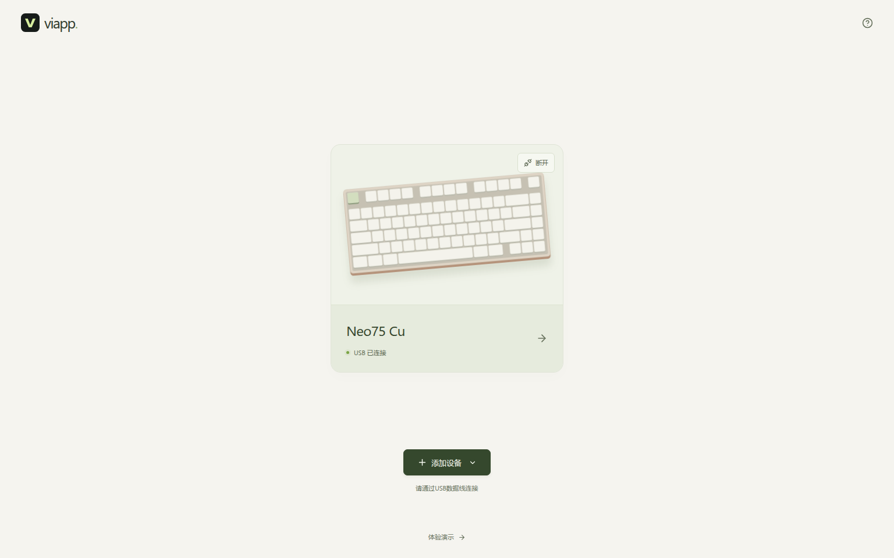

# VIAPP

浏览器里的键盘配置工具，支持改键、快捷键、图层管理、宏编辑和按键测试。

[打开网页驱动](https://zackleo219.github.io/viapp/) · [Windows 离线版](https://github.com/ZackLeo219/viapp/releases/latest/download/viapp-windows-x64.exe) · [其他下载](https://github.com/ZackLeo219/viapp/releases)

## 支持的键盘

VIA 键盘会自动匹配内置定义库，已补入 Neo、QK、Owlab、Cub、EVO 和 TOFU 的公开定义。共享 USB 编号的 PCB 需要选择一次版本；缺少定义时可导入厂商 VIA JSON。

ZMK 已接入 TOFU60 3.0、TOFU65 3.0、TOFU TKL 和 TOFU PAD 的原装双模 PCB，配列直接从固件读取，无需 JSON。

以下型号已通过 USB 真机验证，其余型号仍待实测：

| 型号     | PCB          | 功能                                       |
| -------- | ------------ | ------------------------------------------ |
| Neo75 Cu | 原装三模 PCB | 改键、快捷键、宏、物理配列、按键测试       |
| Neo65 Cu | 原装三模 PCB | 改键、快捷键、宏、物理配列、按键测试       |
| TOFU PAD | 原装双模 PCB | 改键、快捷键、双功能键、图层管理、按键测试 |

使用电脑上的 **Chrome 或 Edge** 打开网页，请通过USB数据线连接。灯效和旋钮暂请使用原厂工具；ZMK 暂不支持在线编辑宏。需要专用驱动的 PCB 不在通用 VIA 支持范围内。

## 使用

1. 接上 USB，键盘切换到有线模式。
2. 点击「添加设备」，选择 VIA 或 ZMK，再在浏览器授权窗口中选择设备。
3. 点击设备卡片，选中键位后按下目标键，也可以搜索功能。

型号和配列自动加载，PCB 选择和导入的定义会保留。授权有效时会自动连接；Neo65 Cu 等未提供 USB 序列号的键盘，拔插后需要再次授权，点击原设备卡片「重新连接」即可。

改键默认**自动保存**，宏编辑完成后点击「保存宏」。底部显示「已保存到键盘」即生效。关闭自动保存后，需要手动保存。载入整套配置或备份时，需要确认后写入。

「本地配置」和自动备份保存在当前浏览器，可导出 JSON 备份或迁移。无法连接时，先关闭正在连接同一键盘的其他驱动页面。

## 离线使用

下载后双击 `viapp-windows-x64.exe`，在 Chrome / Edge 中打开 `http://localhost:5178/`。关闭程序窗口即可退出。

在线版与离线版的本地配置分别保存，可通过 JSON 导入、导出迁移。

## 反馈与贡献

遇到问题或想支持更多键盘，请[提交 Issue](https://github.com/ZackLeo219/viapp/issues)。参与开发见[贡献指南](CONTRIBUTING.md)。

非官方开源项目 · [MIT 许可证](LICENSE) · [第三方声明](THIRD_PARTY_NOTICES.md)
